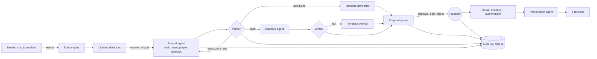

# Gallery: the AI producer's desk for match-day studios

**Gallery turns a live stream of synthetic football events into explainable on-screen insights, and puts a human producer in charge of what goes on air.**

A crew of AI agents built with Microsoft Agent Framework on a Microsoft Foundry model watches every pass, press and shot. They propose insights that explain *why* a moment matters, and a deterministic verifier checks every number, name and minute before a card reaches the producer. The producer approves, edits or rejects each one. Approved insights air as timed broadcast graphics, then fan out into personalized feeds for casual fans, analysts, followers of one player, and Spanish speakers. Every step is written to an audit trail.

Built for the Microsoft x Premier League **Inside the Game: Developer Hackathon**, challenge *The Synthetic Match Insights Engine for Premier League Studio*.

> All clubs (Northgate FC, Harbour Athletic), players and matches are synthetic. No real league data, footage or trademarks are used.

- **Live demo:** https://gallery.livelywave-ba42e696.westus2.azurecontainerapps.io/ (Azure Container Apps). Pick a match, press **Start match**, and choose 15× or 30× speed. The demo replays the agent crew's recorded Microsoft Foundry replies, so it is fast and free to run. The first load after a quiet spell can take a few seconds while the app wakes up.
- **MCP endpoint:** `https://gallery.livelywave-ba42e696.westus2.azurecontainerapps.io/mcp`
- **Demo video:** _added after recording_

## Why a producer's desk?

Most AI sports demos talk straight to fans. Real broadcasts don't work that way: a producer in the gallery (the control room) decides what goes on screen. Gallery is built for that person:

- **Nothing unverified airs by accident.** The verifier rejects drafts with wrong figures, unknown players or future minutes, and the agent gets one chance to fix them. If the draft still fails, a template built straight from the stats is used instead.
- **Humans keep control.** Insights wait for approval. Only low-risk items (player speed tags) can be set to auto-air. Edits are re-checked, and an edit that adds unverified content still airs but is logged as an *override*.
- **Everything is auditable.** Moments, each agent step with its latency, verifier results, approvals, edits, overrides, rejections with reasons, and expiries. Export it from the console or at `GET /api/audit`.
- **Machine-readable output.** Aired overlays are available with their timing at `GET /api/overlays` and stream over the WebSocket, ready for a graphics renderer.
- **Open to other agents.** A read-only MCP server at `/mcp` gives a broadcaster's own AI agents the same verified match data Gallery's crew uses.

## The five stages, mapped to code

| Stage | What happens | Where |
|---|---|---|
| 1. Ingest | A seeded simulator plays a 90-minute match event by event: passes, carries, shots, tackles, interceptions, pressures, possession changes, sprints, fouls, cards, substitutions. Scripted story beats sit on top of random play. | `gallery/sim/` |
| 2. Interpret | Deterministic stats: possession, pass accuracy, pass distance and difficulty rating (1–10), ball and shot speed, pressing intensity, momentum, and a control-vs-chaos index. Rule-based detectors flag pressing surges, momentum swings, milestones, speed thresholds, big chances, goals and substitutions. | `gallery/stats/` |
| 3. Explain | The agent crew: an **Analyst** with stats tools drafts the insight, the **Verifier** checks it, **Graphics** turns it into an overlay (checked again), the **Personalizer** writes four audience versions, and **Recap** writes half-time and full-time summaries. | `gallery/agents/` |
| 4. Render | Lower-thirds, stat cards and player tags, with timing. Live program preview with tally light, scorebug, momentum and control-vs-chaos meters. | `web/`, `gallery/runtime.py` |
| 5. Personalize | Casual, Analyst, Following (pick any player), and Español feeds, each verified, with template fallbacks. | `gallery/agents/crew.py` |

## Architecture



- **Agents:** Microsoft Agent Framework (`agent-framework-core`, `OpenAIChatCompletionClient`) on a **Microsoft Foundry** model deployment.
- **Replay cache:** every model reply is cached by request hash. `GALLERY_PROVIDER=replay` replays a recorded match at zero cost and with deterministic output, which makes demos and judging reliable.
- **Resilience:** 8-second timeout, back-off on rate limits (the provider badge turns amber and templates take over), crew concurrency cap, proposals expire when stale, and clients that reconnect mid-match get a full snapshot.
- **Hosting:** one container on **Azure Container Apps** (scales to zero).

## Plug in your own agents (MCP)

Gallery serves a read-only [Model Context Protocol](https://modelcontextprotocol.io) endpoint at `/mcp` (streamable HTTP, stateless). Any MCP client, such as GitHub Copilot agent mode, Claude, or a Foundry agent, can connect and call:

| Tool | Returns |
|---|---|
| `get_match_state` | Score, clock and both teams' statistics |
| `get_team_stats(team)` | One team's statistics (`NOR` or `HAR`) |
| `get_player_stats(player_id)` | One player's statistics, for example `NOR-6` |
| `compare_windows(team, minutes)` | The last N minutes against the N before |
| `list_on_air` | Overlays the producer has aired, with timing |
| `list_players` | Both squads with ids and positions |

Every tool is marked read-only. Nothing over MCP can change the match, the queue or the audit trail.

## Run it locally

You need Python 3.11+.

```bash
pip install -e ".[dev]"
uvicorn gallery.app:create_app --factory --port 8000
```

Open http://localhost:8000, pick a match, and press **Start match**. With no keys set, Gallery runs in `replay` mode: cached replies play back, and anything not cached falls back to verified templates.

### Using a model

Create a `.env` file (it is git-ignored):

```
# Microsoft Foundry
GALLERY_PROVIDER=foundry
FOUNDRY_ENDPOINT=https://<your-resource>.openai.azure.com
FOUNDRY_KEY=<key>
FOUNDRY_DEPLOYMENT=<deployment name, e.g. gpt-4.1-mini>

```

### Tests

```bash
pytest
```

The suite covers simulator determinism, every stats formula, every detector, the verifier (wrong numbers, unknown players, future minutes), every crew fallback path, the producer actions (double approval, expiry, edits, overrides, restarts), and the API.

## Deploy to Azure Container Apps

```bash
az containerapp up --name gallery --resource-group gallery-rg --location <region> \
  --source . --ingress external --target-port 8000 \
  --env-vars GALLERY_PROVIDER=foundry FOUNDRY_ENDPOINT=<endpoint> FOUNDRY_DEPLOYMENT=<deployment> FOUNDRY_KEY=secretref:foundry-key
```

## Microsoft technology used

- **Microsoft Foundry:** model deployment for every agent
- **Microsoft Agent Framework:** agents, function tools, chat client
- **Model Context Protocol:** read-only match data for external agents
- **Azure Container Apps:** hosting, scale to zero

## License

MIT. See [LICENSE](LICENSE).
